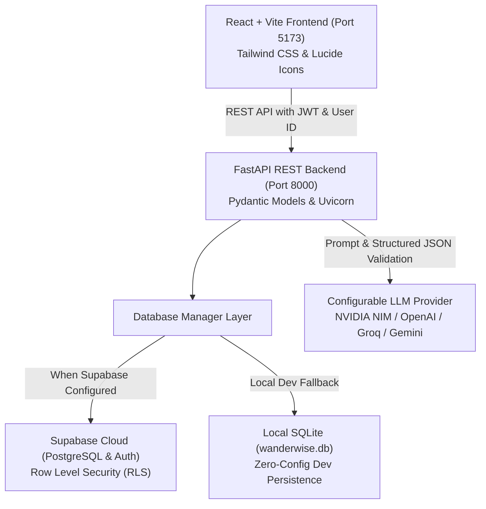

# WanderWise AI – Personalized Travel Itinerary Planner

WanderWise AI is a full-stack, AI-powered travel planning application. It generates personalized, day-by-day travel itineraries based on destination, dates, travelers, budget, travel style, interests, pace, and special dietary/accessibility requirements.

---

## 1. System Architecture



---

## 2. Key Features

### A. Generative AI Itinerary Generation
- **Configurable LLM Integration**: Supports NVIDIA NIM (default: `nvidia/nemotron-3.5-bolt-e4b`), OpenAI (`gpt-4o-mini`), Groq (`llama-3.3-70b-versatile`), and Google Gemini (`gemini-2.0-flash`) via backend environment variables.
- **Structured Pydantic Output**: Outputs verified JSON schemas with day-by-day activities, clock times, locations, categories, and estimated costs.
- **End-to-End Persistence**: Generates and persists the complete schedule to Supabase (or SQLite dev database). Trips are only marked as AI-generated after both generation and database persistence succeed.
- **Graceful Error Handling**: Manages rate limits, timeouts, missing API keys, and model errors gracefully with informative error messages.

### B. Honest & Useful AI Recommendations
- **Realistic Scheduling**: Groups morning, afternoon, and evening activities by geographic proximity to avoid impossible transit times.
- **Estimated Cost Labels**: All ticket prices, dining, and transit expenses are clearly labeled as estimates.
- **Truthful Disclaimer**: Explains that recommendations are planning estimates and venue hours, ticket availability, and transport must be verified directly with venues.

### C. Interactive Itinerary Management
- **Full AI Generation**: Generate complete itineraries from scratch or custom user prompts.
- **Single-Day AI Regeneration**: Regenerate any selected day (`POST /api/trips/{trip_id}/generate-day`) with custom instructions without changing other days.
- **Granular Activity CRUD**:
  - Add activities to any day (`POST /api/trips/{trip_id}/days/{day_id}/activities`).
  - Edit activity title, description, time slot, location, category, or cost (`PUT /api/trips/{trip_id}/activities/{activity_id}`).
  - Remove activities (`DELETE /api/trips/{trip_id}/activities/{activity_id}`).
- **Edit Day Notes**: Update day summary, accommodation guidance, dining suggestions, transit tips, and day-level costs (`PUT /api/trips/{trip_id}/days/{day_id}`).
- **Relationship & Ownership Verification**: Validates trip IDs and ensures users cannot modify trips belonging to other users.

### D. Comprehensive Budget Management
- Calculates live cost totals dynamically from saved itinerary data:
  - **Total Planned Budget**
  - **Estimated Accommodation Cost**
  - **Estimated Food / Dining Cost**
  - **Estimated Transportation Cost**
  - **Estimated Activity Cost**
  - **Remaining Budget** (color-coded green or red)
- **Over-Budget Warning**: Real-time alert banner displayed whenever estimated total costs exceed the user's allocated budget.
- Clear distinction between planning estimates and actual charged expenses.

### E. Dashboard Improvements
- Real-time trip list loaded from backend / Supabase.
- Quick summary metrics (Total Trips, Upcoming, Planned Budget, Unique Destinations).
- Action controls on every trip card:
  - **Open Plan**: View full day-wise schedule and budget breakdown.
  - **Edit Trip**: Modal to quickly adjust title, budget, status, and notes.
  - **Regenerate Plan**: Trigger AI or template regeneration with custom prompt modal.
  - **Delete Trip**: Confirmation dialog with cascading cleanup.
- Search and multi-filter controls (filter by status, travel style, and sort by newest, budget, or duration).

---

## 3. Configuration & Environment Variables

### Backend Configuration (`backend/.env`)

Copy `backend/.env.example` to `backend/.env` and configure:

| Variable | Description | Example / Default |
|---|---|---|
| `PROJECT_NAME` | Project title | `"WanderWise AI – Personalized Travel Itinerary Planner"` |
| `DEV_MODE` | Enable zero-config dev mode | `True` |
| `CORS_ORIGINS` | Allowed CORS origins | `["http://localhost:5173", "http://127.0.0.1:5173", "*"]` |
| `SUPABASE_URL` | Supabase project URL | `https://your-project.supabase.co` |
| `SUPABASE_ANON_KEY` | Supabase anonymous key | `eyJhbGciOi...` |
| `SUPABASE_SERVICE_KEY` | Supabase service role key (for backend admin access) | `eyJhbGciOi...` |
| `AI_PROVIDER` | Active AI provider (`nvidia`, `openai`, `groq`, `gemini`) | `nvidia` |
| `NVIDIA_API_KEY` | NVIDIA NIM API key | `nvapi-...` |
| `NVIDIA_MODEL` | NVIDIA NIM model name | `nvidia/nemotron-3.5-bolt-e4b` |
| `NVIDIA_BASE_URL` | NVIDIA NIM endpoint URL | `https://integrate.api.nvidia.com/v1` |
| `OPENAI_API_KEY` | OpenAI API key (if using OpenAI) | `sk-...` |
| `OPENAI_MODEL` | OpenAI model name | `gpt-4o-mini` |
| `OPENAI_BASE_URL` | OpenAI base URL | `https://api.openai.com/v1` |
| `GROQ_API_KEY` | Groq API key (if using Groq) | `gsk_...` |
| `GROQ_MODEL` | Groq model name | `llama-3.3-70b-versatile` |
| `GEMINI_API_KEY` | Google Gemini API key (if using Gemini) | `AIzaSy...` |
| `GEMINI_MODEL` | Google Gemini model name | `gemini-2.0-flash` |

### Frontend Configuration (`frontend/.env`)

| Variable | Description | Example / Default |
|---|---|---|
| `VITE_API_URL` | FastAPI backend URL | `http://localhost:8000/api` |
| `VITE_SUPABASE_URL` | Supabase project URL | `https://your-project.supabase.co` |
| `VITE_SUPABASE_ANON_KEY` | Supabase anonymous key | `eyJhbGciOi...` |

---

## 4. API Endpoints Reference

### Health & Provider Detection
- `GET /api/health` — Returns status, database mode, Supabase state, and active AI model.

### Trips
- `GET /api/trips` — List trips for current user (supports `?all_users=true`).
- `POST /api/trips` — Create new trip and generate baseline itinerary.
- `GET /api/trips/{trip_id}` — Get trip details with all days, activities, and budget metrics.
- `PUT /api/trips/{trip_id}` — Update trip parameters (title, budget, status, notes).
- `DELETE /api/trips/{trip_id}` — Delete trip and all related days and activities.
- `GET /api/trips/stats/summary` — Aggregated dashboard statistics.
- `POST /api/trips/{trip_id}/regenerate` — Reset to baseline template itinerary.

### Part 2 AI & Interactive Management
- `POST /api/trips/{trip_id}/generate` — Execute full AI itinerary generation with custom instructions.
- `POST /api/trips/{trip_id}/generate-day` — Regenerate a single specific day with AI while preserving other days.
- `PUT /api/trips/{trip_id}/days/{day_id}` — Update day guidance, summary, and costs.
- `POST /api/trips/{trip_id}/days/{day_id}/activities` — Add scheduled activity to a specific day.
- `PUT /api/trips/{trip_id}/activities/{activity_id}` — Edit an activity's title, time, category, or cost.
- `DELETE /api/trips/{trip_id}/activities/{activity_id}` — Remove an activity and recalculate budget totals.

---

## 5. Quickstart Guide

### 1. Backend Setup
```bash
cd backend
pip install -r requirements.txt
python -m uvicorn app.main:app --host 127.0.0.1 --port 8000 --reload
```
API Documentation available at: [http://127.0.0.1:8000/docs](http://127.0.0.1:8000/docs)

### 2. Frontend Setup
```bash
cd frontend
npm install
npm run dev
```
Open [http://localhost:5173](http://localhost:5173) in your browser.

### 3. Supabase Cloud Setup (Optional)
1. Create a project at [supabase.com](https://supabase.com).
2. Execute [supabase/schema.sql](./supabase/schema.sql) in the Supabase **SQL Editor**.
3. Add `SUPABASE_URL` and `SUPABASE_ANON_KEY` to `backend/.env` and `frontend/.env`.

---

## 6. Testing & Verification

### Run Part 2 Backend Tests:
```bash
python backend/test_part2.py
```
Validates:
1. Health & AI provider detection.
2. Trip creation & baseline generation.
3. Live AI itinerary generation (`POST /api/trips/{id}/generate`) with NVIDIA NIM.
4. Single-day AI regeneration (`POST /api/trips/{id}/generate-day`).
5. Granular activity CRUD (Add, Edit, Delete).
6. Budget management & over-budget detection.
7. Ownership restrictions & 403 Forbidden enforcement across users.
8. Missing API key & error scenarios (400 Bad Request / 404 Not Found).

### Run Part 1 API Tests:
```bash
python backend/test_api.py
```

### Build Frontend Production Assets:
```bash
npm --prefix frontend run build
```
Builds cleanly to `frontend/dist/` with zero errors.
